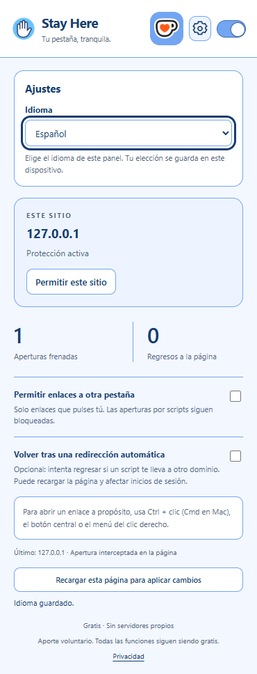

# Stay Here

[English](README.md) · **Español**

<p align="center"></p>

Extensión gratuita para Chrome que ayuda a frenar ventanas y pestañas emergentes, con controles sencillos y excepciones por sitio. Puede utilizarse junto a uBlock Origin Lite.

Mantenido por [laloerraz](https://github.com/laloerraz) · [Licencia MIT](LICENSE)

## Instalar en Chrome

La publicación en Chrome Web Store está pendiente.

1. Descarga **[StayHere-1.1.4.zip](https://github.com/laloerraz/Stay-Here/releases/latest/download/StayHere-1.1.4.zip)**.
2. Haz clic derecho en el ZIP y elige **Extraer todo**.
3. Abre la carpeta extraída. Debes ver **`manifest.json` directamente dentro de ella**, junto a `background.js` y `popup.html`.
4. Abre `chrome://extensions`, activa **Modo de desarrollador** y pulsa **Cargar descomprimida**.
5. Selecciona esa carpeta y recarga las páginas que ya estaban abiertas.

Conserva la carpeta extraída en una ubicación permanente. Chrome la necesita para cargar la extensión.

Los archivos **Source code** y **Code → Download ZIP** son el proyecto para desarrollo. Si usas uno de ellos, la carpeta que debes seleccionar es `extension`, dentro del proyecto extraído. Si Chrome indica que falta el manifiesto, abre la carpeta elegida y comprueba que `manifest.json` esté a la vista, sin entrar a otra subcarpeta.

## Uso

- **Protección global:** activa o pausa la protección desde el interruptor del panel.
- **Permitir este sitio:** añade una excepción para el dominio actual. Los subdominios se gestionan por separado.
- **Permitir enlaces a otra pestaña:** deja abrir los enlaces que pulses, manteniendo el bloqueo de aperturas por scripts.
- **Abrir un enlace deliberadamente:** usa Ctrl + clic —Cmd + clic en Mac—, botón central o el menú contextual.
- **Volver tras una redirección automática:** opción desactivada inicialmente que intenta regresar ante ciertas redirecciones entre dominios.

Pulsa el botón **Ajustes** (engranaje) para elegir **Español** o **English**. La elección se guarda en este dispositivo; el idioma predeterminado de una instalación nueva es inglés.

Después de cambiar opciones de protección o excepciones, recarga las páginas abiertas para aplicar todos los cambios. El panel incluye un botón para recargar la página actual.



## Límites

El bloqueo puede afectar ventanas legítimas de acceso, pago o reproducción. Si ocurre, permite el sitio y recarga. Una pestaña emergente puede aparecer brevemente antes de cerrarse.

Stay Here no elimina todos los anuncios ni garantiza detener toda apertura o redirección. El regreso opcional puede recargar formularios o reproducción y afectar inicios de sesión. Los contadores son orientativos.

No funciona en páginas internas del navegador ni en Chrome Web Store. Para usarla en incógnito debes habilitarla expresamente. Si la desinstalas, recarga las páginas abiertas para retirar la protección ya instalada.

## Privacidad

La protección funciona en tu navegador, sin servidores propios, analítica ni anuncios. Las preferencias se guardan localmente; las direcciones y los estados temporales de pestañas se procesan durante la sesión y no se envían al desarrollador.

Consulta la [política de privacidad y explicación de permisos](docs/privacy.html).

## Apoya el desarrollo

Todas las funciones son gratuitas. Puedes [apoyar Stay Here en Ko-fi](https://ko-fi.com/laloerraz) desde el panel de la extensión o desde **Sponsor** en GitHub. El aporte es voluntario y el pago se realiza en Ko-fi; la extensión no recibe datos de tu tarjeta.

## Pruebas y desarrollo

Desde la raíz del repositorio:

```sh
node --test tests/protection.test.cjs
```

La [guía de desarrollo](docs/DESARROLLO.md) explica la estructura, las comprobaciones y cómo generar el paquete. También puedes consultar los [resultados de pruebas](docs/PRUEBAS.md) y el [historial de cambios](docs/CHANGELOG.md).

El símbolo de Ko-fi es una marca de terceros; consulta los [avisos de marca](extension/THIRD_PARTY_NOTICES.txt).

## Comunidad

Comparte preguntas e ideas en [Discussions](https://github.com/laloerraz/Stay-Here/discussions) y comunica errores en [Issues](https://github.com/laloerraz/Stay-Here/issues). Para proponer código, consulta la [guía de colaboración](.github/CONTRIBUTING.md). Las propuestas se incorporan solo por decisión del mantenedor.
