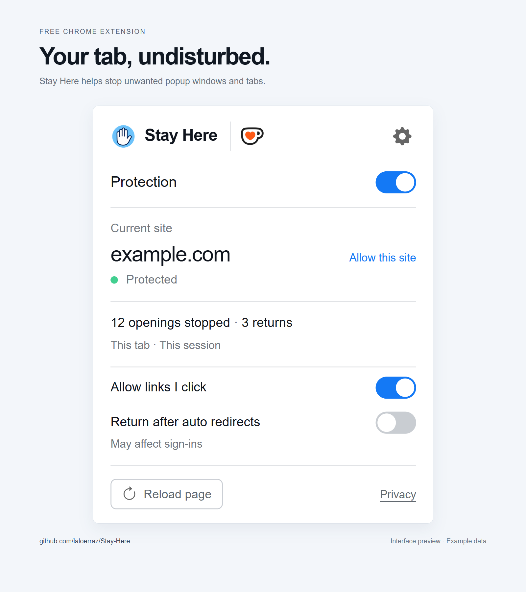
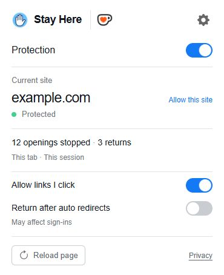

# Stay Here

**English** · [Español](README.es.md)

<p align="center"></p>

A free Chrome extension that helps stop unwanted popup windows and tabs, with simple controls and per-site exceptions. It can be used alongside uBlock Origin Lite.

Maintained by [laloerraz](https://github.com/laloerraz) · [MIT license](LICENSE)

## Preview and demo

[](docs/imagenes/stay-here-official-1600x1800.png)

**[Watch the final demo video (MP4)](https://github.com/laloerraz/Stay-Here/releases/download/v1.1.5/StayHere-Reddit-1080p-final.mp4)** · [Open full-resolution image (1600 × 1800)](docs/imagenes/stay-here-official-1600x1800.png)

Illustrative interface preview with example data.

## Install in Chrome

Chrome Web Store publication is pending.

1. Download **[StayHere-1.1.5.zip](https://github.com/laloerraz/Stay-Here/releases/latest/download/StayHere-1.1.5.zip)**.
2. Right-click the ZIP and choose **Extract all**.
3. Open the extracted folder. **`manifest.json` must be directly inside it**, alongside `background.js` and `popup.html`.
4. Open `chrome://extensions`, enable **Developer mode** and click **Load unpacked**.
5. Select that folder and reload any pages that were already open.

Keep the extracted folder in a permanent location: Chrome needs it to load the extension.

**Source code** archives and **Code → Download ZIP** contain the development project. If you use one, select the `extension` folder inside the extracted project. If Chrome reports a missing manifest, check that the selected folder contains `manifest.json` directly, without opening another subfolder.

## Use

- **Global protection:** turn protection on or off with the switch in the panel.
- **Allow this site:** add an exception for the current domain. Subdomains are handled separately.
- **Allow clicked links to open new tabs:** allow links you click while keeping scripted openings blocked.
- **Open a link deliberately:** use Ctrl + click (Cmd on Mac), the middle mouse button or the right-click menu.
- **Return after an automatic redirect:** an option, off by default, that tries to return after certain cross-domain redirects.

Open **Settings** (the gear button) to choose **English** or **Español**. Your choice is saved on this device. New installations start in English.

After changing protection options or site exceptions, reload open pages to apply all changes. The panel has a button to reload the current page.



## Limits

Blocking can affect legitimate sign-in, payment or playback windows. If that happens, allow the site and reload it. A popup tab may appear briefly before it is closed.

Stay Here does not remove every advertisement or guarantee that every opening or redirect will be stopped. The optional return can reload forms or playback and affect sign-ins. Counters are approximate.

It does not run on internal browser pages or Chrome Web Store. Incognito use must be enabled explicitly. If you uninstall the extension, reload open pages to remove protection already installed in them.

## Privacy

Protection runs in your browser, without servers of our own, analytics or advertising. Preferences are saved locally. Tab addresses and temporary state are processed during the session and are not sent to the developer.

Read the [privacy policy and permission explanations](docs/privacy.en.html), also [available in Spanish](docs/privacy.html).

## Support development

Every feature is free. You can [support Stay Here on Ko-fi](https://ko-fi.com/laloerraz) from the extension panel or **Sponsor** on GitHub. Support is optional; payment takes place on Ko-fi and the extension does not receive your card details.

The Ko-fi symbol is a third-party mark; see the [brand notices](extension/THIRD_PARTY_NOTICES.txt).

## Tests and development

From the repository root:

```sh
node --test tests/protection.test.cjs
```

The [development guide (Spanish)](docs/DESARROLLO.md) explains the structure, checks and packaging. See also the [test results (Spanish)](docs/PRUEBAS.md) and [changelog (Spanish)](docs/CHANGELOG.md).

## Community

Share questions and ideas in [Discussions](https://github.com/laloerraz/Stay-Here/discussions), and report bugs in [Issues](https://github.com/laloerraz/Stay-Here/issues). For code proposals, see the [contribution guide (Spanish)](.github/CONTRIBUTING.md). The maintainer decides which proposals are incorporated.
