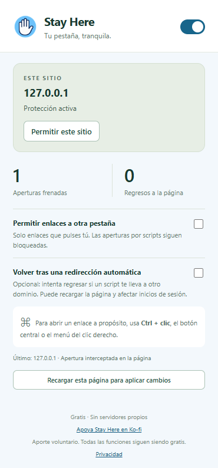

# Stay Here

<p align="center"></p>

Mantenido por [laloerraz](https://github.com/laloerraz) · [Licencia MIT](LICENSE) · [Privacidad](privacy.html)

Extensión gratuita para Chrome que ayuda a frenar aperturas de pestañas y ventanas emergentes. Puede usarse junto a uBlock Origin Lite, que no es obligatorio. No elimina todos los anuncios ni garantiza detener toda redirección.

## Instalación local

1. Abre `chrome://extensions` y activa el modo de desarrollador.
2. Pulsa **Cargar descomprimida** y elige esta carpeta, que contiene `manifest.json`.
3. Recarga las páginas que ya estaban abiertas y fija el icono de Stay Here.

## Uso

- La protección está activa inicialmente. El bloqueo es agresivo: también puede afectar ventanas legítimas de acceso, pago o reproducción.
- **Permitir este sitio** desactiva la protección para ese dominio exacto; los subdominios se gestionan por separado.
- **Permitir enlaces a otra pestaña** permite los enlaces que pulses, manteniendo el bloqueo de aperturas por scripts.
- Usa **Ctrl + clic** (Cmd en Mac), botón central o el menú contextual para abrir deliberadamente una pestaña.
- **Volver tras una redirección automática** comienza desactivado. Intenta volver ante determinadas navegaciones por script entre dominios; el destino puede empezar a cargar. Puede recargar formularios o reproducción y afectar accesos.
- Tras cambiar opciones o excepciones, recarga las páginas abiertas. El panel incluye un botón para recargar la actual.

## Seguridad y límites

Las opciones que usa la protección de scripts se inyectan desde el service worker mediante `chrome.scripting`, ligadas al identificador exacto del documento, y quedan en una clausura privada hasta recargar. Los mensajes públicos de la página no pueden desactivarlas. El canal de informes de bloqueos es orientativo: un sitio puede falsificar contadores, pero esos informes no conceden permisos ni modifican ajustes.

La instalación de la protección de scripts es asíncrona después de consultar las opciones; no se garantiza interceptar scripts que se ejecuten antes. El cierre de pestañas desde el service worker es una defensa adicional y una pestaña puede aparecer brevemente antes de cerrarse. No es una barrera de seguridad absoluta contra una página hostil.

No funciona en páginas internas de Chrome ni en Chrome Web Store. Para incógnito debes habilitarlo expresamente. Al desinstalar, recarga las páginas para retirar las protecciones instaladas.

## Privacidad y permisos

Sin servidores propios, analítica, anuncios ni código remoto. Los ajustes y excepciones se guardan localmente; las direcciones y estados temporales de pestañas se procesan en memoria y `storage.session`. Detalles en [privacy.html](privacy.html).

Permisos: `storage` para ajustes/estado, `webNavigation` para aperturas y navegaciones, `scripting` para instalar la política de protección y acceso HTTP/HTTPS para actuar en los sitios.

## Ko-fi

Todas las funciones siguen siendo gratis. Puedes [apoyar el desarrollo en Ko-fi](https://ko-fi.com/laloerraz) desde el botón del panel o desde Sponsor en GitHub. La página de pago se abre únicamente cuando pulsas el enlace. No se cargan widgets ni scripts externos y la extensión no recibe datos de tu tarjeta.

## Pruebas

```powershell
node --test tests/protection.test.cjs
```

La comprobación opcional `tests/extension-smoke.cjs` requiere Playwright y un navegador con carga de extensiones por línea de comandos (Chromium/Chrome for Testing o un Edge compatible). Usa un perfil temporal independiente. Puedes indicar su ejecutable con `STAYHERE_BROWSER`.

## Paquete para Chrome Web Store

```powershell
powershell -ExecutionPolicy Bypass -File scripts/package.ps1
```

Genera `dist/StayHere-1.1.1-chrome.zip` con una lista explícita de archivos de producto; excluye documentación de desarrollo, pruebas y diseños. El manifiesto queda en la raíz del ZIP.

## Publicación y repositorio

Sube el contenido de esta carpeta al repositorio personal que elijas. El repositorio oficial es [laloerraz/Stay-Here](https://github.com/laloerraz/Stay-Here). La distribución en Chrome Web Store está pendiente. No incluyas perfiles de navegador, contraseñas, `.pem` ni `.env`.

Antes de enviar a revisión, sigue [store/PENDIENTES.txt](store/PENDIENTES.txt). Las capturas y el texto de ficha están en `store/`. La política puede publicarse como sitio estático desde `docs/` cuando configures un alojamiento público. Un repositorio privado por sí solo no vuelve accesible la política: comprueba la URL sin iniciar sesión.

## Vista del panel



## Apoyo

[Apoya Stay Here en Ko-fi](https://ko-fi.com/laloerraz). Los aportes son voluntarios; no hay funciones de pago.

## Privacidad del repositorio

El código y las pruebas no contienen credenciales de pagos. El único dato de Ko-fi integrado es el enlace público del creador. Consulta [docs/REPOSITORIO_Y_PRIVACIDAD.md](docs/REPOSITORIO_Y_PRIVACIDAD.md) para distinguir archivos públicos, datos privados e historial.
